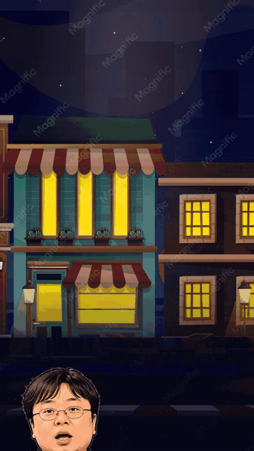
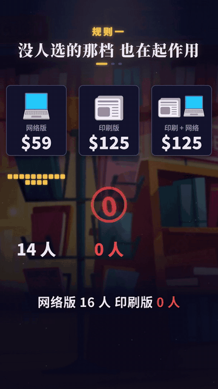
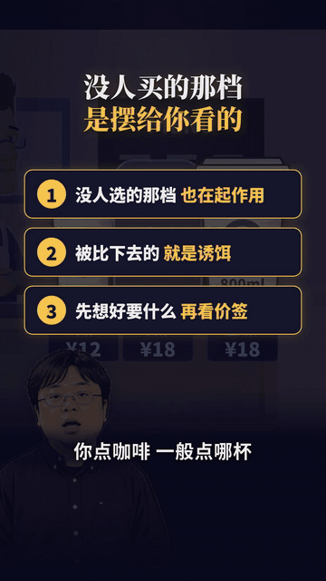
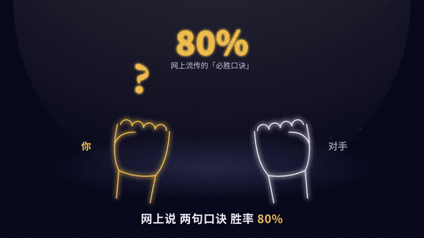

# vibe-knowledge-shorts

**用 AI 做「Vibe知识大赏」风格的 1 分钟知识短视频**：没有配音，字幕就是旁白；暗底发光画面，卡着配乐的节拍；讲 3 条层层递进的规则，再穿插几个梗。

画面全部是代码（[Remotion](https://www.remotion.dev/)，用 React 写视频），代码由 [Claude Code](https://claude.com/claude-code) 写。人负责三件事：选题、定方向、挑毛病。

## 本期演示：《诱饵价格》——咖啡的大杯是卖给谁的？

60 秒，讲诱饵效应的 3 条规则，中间埋了 5 个梗。完整源码在 [`examples/诱饵价格/`](examples/诱饵价格/)，成片见 [完整版（只音效）](examples/诱饵价格/demo/诱饵价格_完整版_只音效.mp4)。

| ① 说出潜规则 | ② 层层加码 | ③ 冷停顿 |
|:-:|:-:|:-:|
|  |  |  |
| 「大杯是卖给谁的？」<br>「大杯不卖。是用来让您买超大杯的。」 | 「那我偏要大杯！」<br>「……系统里没有这个按钮。」 | 超大杯：超值之选 / 店长推荐 / 人生首选<br>大杯：「600ml。」（没了） |

| ④ 把诱饵演成人 | ⑤ 人生感悟收尾 |
|:-:|:-:|
|  |  |
| 没人选的印刷版：「没人选我 但我一直在上班」<br>被拿掉后，套餐从 84 人掉到 32 人：「你回来上班！」 | Ariely 的照片实验：<br>「所以合照 带个像你但更丑的朋友」 |

每个梗的手法和出处见 [笑点手册](docs/03_笑点手册.md)。**删掉这个梗，知识点也就断了**——这才叫梗。

<details><summary>上一期：《石头剪刀布》（横屏、发光线描风）</summary>
<p align="center">
  
  
</p>
</details>

## 这套做法的核心（5 句话）
1. **选题**：一个人人碰到过的小问题，加上一个能查到论文的反常识数字。比如「石头剪刀布第一把出什么」「咖啡的大杯是卖给谁的」。
2. **讲成 3 条规则**，一条推一条，最后落到「下次你该怎么做」。
3. **先找形象，再写字**：每个概念找一样外行认得的东西来演，不用点、线、圈代替。每个画面动手前，先找一张爆款截图对照着做。
4. **字幕和画面卡在配乐小节线上**：112.9 BPM，每小节 2.126 秒，一句字幕占一小节。
5. **加梗**：让角色一本正经地把知识点演出来。比如店员说「大杯不卖。是用来让您买超大杯的。」

## 目录
| 路径 | 是什么 |
|---|---|
| [`docs/01_选题.md`](docs/01_选题.md) | 132 条爆款统计出来的选题规律 + 事实表怎么做 |
| [`docs/02_制作流程.md`](docs/02_制作流程.md) | 11 步流程、硬规矩、审片 9 维、常见坑 |
| [`docs/03_笑点手册.md`](docs/03_笑点手册.md) | 从 5 条爆款里拆出的 7 个搞笑手法，每个附原句，外加一个实战例子 |
| [`docs/04_声音.md`](docs/04_声音.md) | 配乐对齐小节、音效怎么挂、混音和响度 |
| [`docs/05_怎么跟Claude说.md`](docs/05_怎么跟Claude说.md) | 直接能复制的提示词 |
| [`docs/06_发布.md`](docs/06_发布.md) | 封面尺寸、B 站 / 抖音 / 小红书文案模板 |
| [`template/`](template/) | 可以直接跑的 Remotion 工程（《石头剪刀布》那一期的完整源码） |
| [`examples/诱饵价格/`](examples/诱饵价格/) | 本期竖屏真实场景版的完整源码 + 5 个梗的动图 |
| [`sfx/`](sfx/) | 16 个程序合成的音效，版权自有，可以随便用 |
| [`skill/vibe-video/`](skill/vibe-video/SKILL.md) | Claude Code skill，装上后输入 `/vibe-video` 就照这套流程走 |

## 上手
需要 Node.js 20+、ffmpeg、Python 3（装 numpy 和 scipy）、中文字体 Noto Sans/Serif CJK。

```bash
git clone https://github.com/zhuhxi/vibe-knowledge-shorts.git && cd vibe-knowledge-shorts/template
npm install
python3 audio_mix.py          # 生成音轨；没放配乐就只出音效版
npx remotion studio           # 浏览器里边看边改
npx remotion render src/index.ts Film out/demo.mp4
```

然后打开 Claude Code，把 [`docs/05_怎么跟Claude说.md`](docs/05_怎么跟Claude说.md) 里的第一段话发给它，换成你自己的题目。

## 模板怎么改成你的片子
- `src/script.ts`：字幕稿。一句一行，`t` 是出现时间，用 `B(k)` 对齐小节；`color` 给关键词上色。
- `src/Film.tsx`：画面。每个场景都是一个组件，按时间 `t` 决定显示什么、怎么动。
- `src/kit.tsx`：公共零件，包括时间工具 `span / ease / mix`、字幕、发光滤镜、对话气泡 `Bubble`。
- `audio_mix.py`：音效挂点。
- 模板是横屏 1920×1080。要做竖屏，就把 `Root.tsx` 里的尺寸改成 1080×1920，再把 `kit.tsx` 里的 `W / H` 也改掉。

## 版权说明
- 代码用 MIT 协议；`sfx/` 里的音效是程序合成的，可以商用。
- **不附带配乐**：自己选曲，放到 `template/music/bgm.m4a`，版权自己核实。
- `examples/诱饵价格/` 的背景是 Magnific 免费素材的带水印预览图，只作演示，作者见 [来源](examples/诱饵价格/public/assets/来源.md)；人物是罗永浩插画，玩他「这是大杯」的梗。你做自己的片子请换成有授权的素材。
